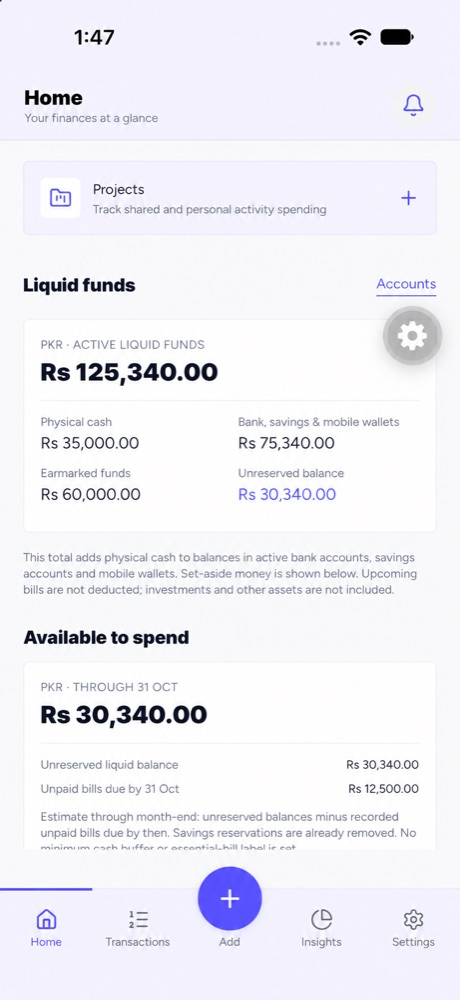
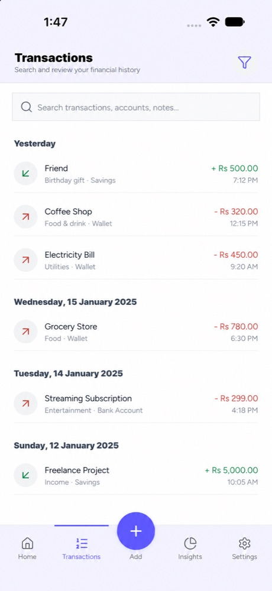
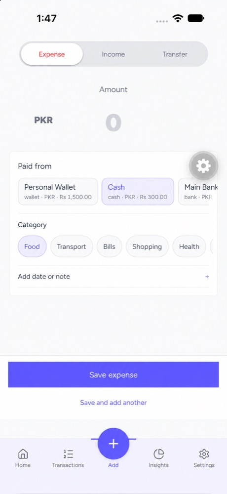
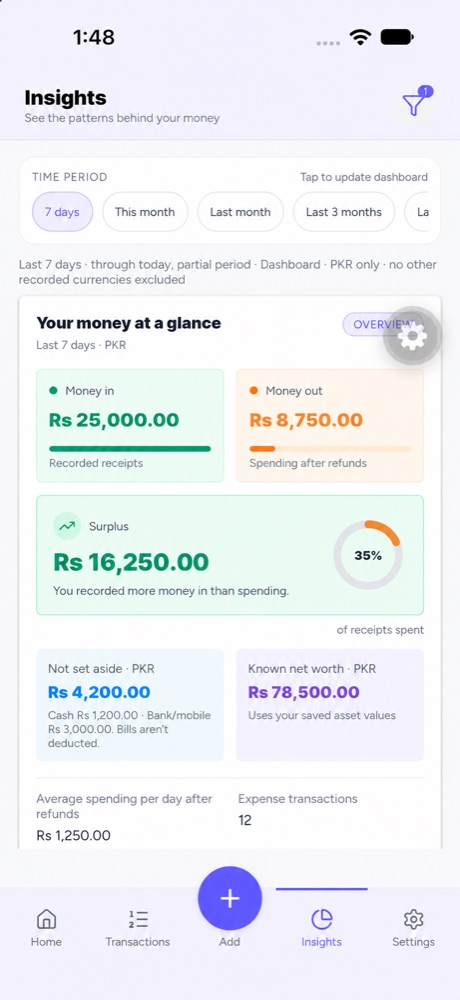
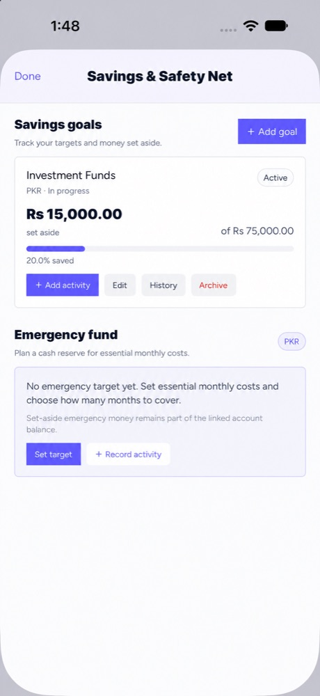
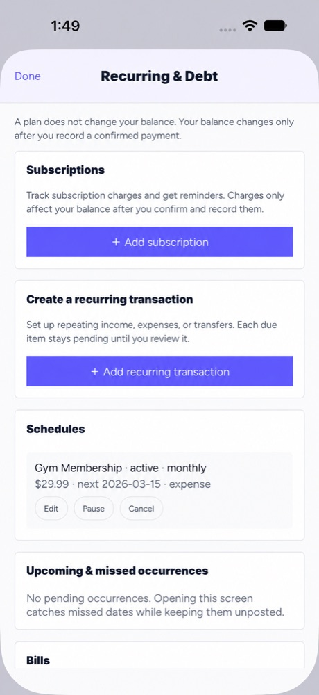
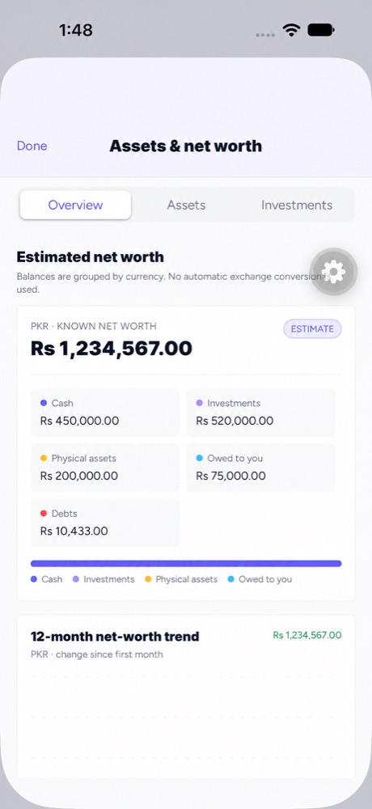
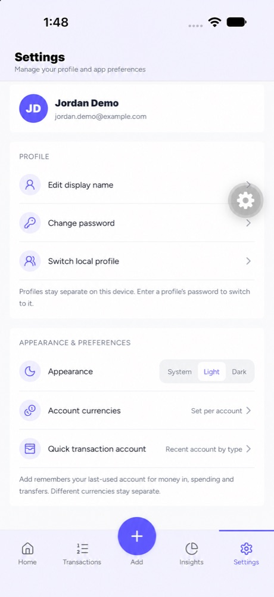

# Leverage

<p align="center">
  <strong>A local-first personal finance app for understanding where your money is, where it goes, and what it is committed to.</strong>
</p>

<p align="center">
  
  
  
  
</p>

Leverage (the repository is named **HouseLog**) helps people manage day-to-day finances and understand their wider financial position. It brings account balances, transactions, budgets, savings, upcoming obligations, assets, projects, and insights together in one mobile app.

> Screenshots below are illustrative demo captures. Names, balances, transaction details, and other personal information have been replaced with synthetic examples.

## Screenshots

<p align="center">
  
  
  
  
</p>

<p align="center">
  
  
  
  
</p>

## Features

- **Home dashboard:** liquid funds, spendable cash, account summaries, upcoming items, recent activity, and spending trends.
- **Transactions:** record income, expenses, and transfers; review history; search and filter activity.
- **Accounts:** track cash, bank, savings, and mobile-wallet accounts with account-level history.
- **Budgets and savings:** plan monthly category limits, track savings goals, and set an emergency-fund target.
- **Recurring, bills, and debt:** keep schedules and obligations visible, then record confirmed payments when they happen.
- **Assets and net worth:** track assets, investments, liabilities, and balances across supported currencies.
- **Projects:** organize event and group finances with budgets, contributions, pooled funds, expense splits, settlements, and reports. Shared collaboration requires the configured cloud services.
- **Insights:** review income versus spending and category-level activity over a selected period.
- **Optional AI:** consent-gated assistance can use the existing Hono gateway. Provider credentials are handled by the server and are not bundled in the app.
- **Privacy and security:** local financial data uses encrypted SQLite; secure device storage protects local keys. Authentication, backups, and biometric unlock are available where configured and supported.

## How data is stored

The app is local-first. Core financial records are stored in an on-device SQLite database protected with SQLCipher. Amounts use integer minor units, and different currencies remain separate unless a conversion is explicitly implemented. See [Financial model](docs/financial-model.md) for balance and ledger rules.

Cloud features are optional integrations. Authentication, supported synchronization, shared Projects, and AI require the existing Neon services and/or the Hono API to be configured and reachable. The mobile app does not include a database administrator credential or AI provider key. Read [Environment and security](docs/environment-and-security.md) and [the backend guide](backend/README.md) before configuring cloud services.

The repository includes the API implementation; a deployment is needed only for workflows that call it. Running `expo start` does not deploy or start the cloud backend.

## Requirements

- Node.js **22.13 or newer**.
- npm and the committed lockfile.
- Android Studio and Android SDK for local Android native builds; Xcode on macOS for local iOS native builds.
- An installed development build for native functionality. **Expo Go is not supported** because this app uses native modules and `expo-dev-client`.

The project currently uses Expo SDK 57, React Native 0.86, and React 19.2.3. See the [versioned Expo SDK 57 documentation](https://docs.expo.dev/versions/v57.0.0/) when changing Expo configuration or native dependencies.

## Run locally

```sh
npm ci
npx expo start
```

Open the Metro session in an installed Leverage development build. To compile and install a native development build locally:

```sh
npm run android
# On macOS with Xcode:
npm run ios
```

Copy `.env.example` to `.env` only if you are configuring local cloud/API features. The example uses placeholders. Do not put secrets in `EXPO_PUBLIC_*` variables; those values are compiled into the app and visible to its users.

### Optional backend

The app’s local-only flows do not require a backend. To run the existing API for development, use disposable services and credentials:

```sh
cd backend
cp .env.example .env
npm ci
npm run prisma:generate
npm run dev
```

Configure the local `.env` before starting the API. Review the backend documentation and migrations before applying changes to any database. Never point development builds or test accounts at production financial data.

## Verification

```sh
npm run typecheck
npm run lint
npm test
npm run verify:source
```

These commands check source-level behavior and produce a JavaScript bundle where configured. They do not by themselves prove native runtime behavior on every device, production database security, live cross-device synchronization, a deployed backend, or a released EAS build. See the verification notes under [`docs/`](docs/README.md) for their scope and date.

## Build and release

Build profiles are defined in [`eas.json`](eas.json). Hosted builds require a configured Expo/EAS project and the appropriate build environment. Examples:

```sh
eas build --profile production-apk --platform android
eas build --profile production --platform android
```

The first profile is for Android APK distribution; the second produces an Android App Bundle. Review app identity, signing, versioning, environment values, privacy disclosures, and device behavior before distribution. No GitHub Actions workflow is configured. Do not commit APK, AAB, IPA, signing keys, or local build output.

## Documentation

- [Documentation index](docs/README.md)
- [Codebase guide](docs/codebase-guide.md) — startup, navigation, data flow, and folder map.
- [Financial model](docs/financial-model.md) — ledger, balances, account movements, savings, and Projects accounting.
- [Environment and security](docs/environment-and-security.md) — configuration, secret handling, and publication checklist.
- [AI foundation](docs/ai-foundation.md) — consent, providers, credentials, and gateway behavior.
- [Backend guide](backend/README.md) — API, auth, cloud boundaries, local development, and deployment notes.
- [Android verification notes](docs/android-phase-2a-verification.md) · [Phase 2B](docs/android-phase-2b-verification.md) · [Phase 2C](docs/android-phase-2c-verification.md)

## Contributing and security

Read [CONTRIBUTING.md](CONTRIBUTING.md) before opening a pull request. All contributors are expected to follow the [Code of Conduct](CODE_OF_CONDUCT.md). Please report vulnerabilities privately using the process in [SECURITY.md](SECURITY.md), not in a public issue.

Before making this repository public, review the [security and publication checklist](docs/environment-and-security.md#repository-audit-and-release-checklist), third-party asset licenses, database policies, and Git history. The current checkout contains no live `.env` files, but historical commits include public Neon endpoint URLs; see the documented history note before changing repository visibility.

## License

Leverage is licensed under the [MIT License](LICENSE). Third-party dependencies, fonts, and assets may have their own licenses and notices.
