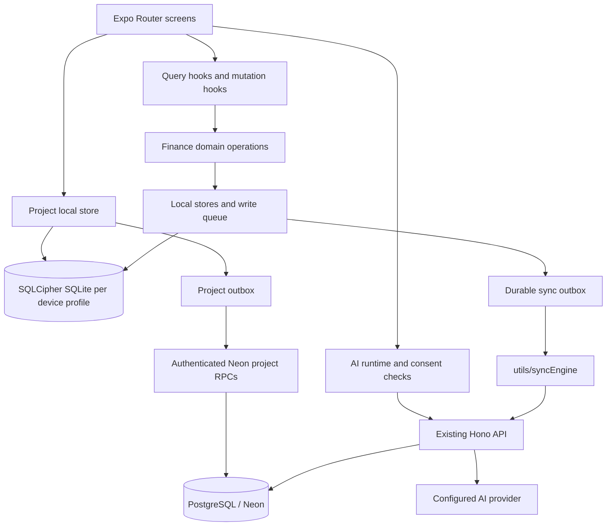

# Codebase and runtime guide

This page maps the Leverage app from launch through local financial writes, cloud sync, shared projects, and AI requests. It describes the current implementation; see [the backend release boundary](../backend/README.md#deliberate-release-boundary) before assuming every local feature is cloud-synced.

## Architecture at a glance



The app is local-first. Financial screens read from the device database through domain stores and query hooks. Cloud services are optional integrations. The Hono API and Neon Data API are separate request paths that use the same configured Neon account/database; project collaboration uses dedicated database functions rather than the generic financial change feed.

## Startup and navigation

1. Expo loads `app/_layout.tsx`, fonts, notification handling, React Query, and the root navigation stack.
2. `AuthProvider` restores the active local profile/session and profile preferences from device storage. Cloud identity is linked separately; a local profile is not the same thing as a Neon account.
3. `RootNavigator` waits for session/font state, then routes signed-out profiles to `app/(auth)` and signed-in profiles to `app/(tabs)` or first-run onboarding.
4. When the profile is locked, `LockScreen` overlays the navigator. The database key remains in device-protected SecureStore; an app lock is a UI/access gate, while SQLCipher supplies database-file encryption.
5. The tab group owns the main Home, Transactions, Add, Insights, and Settings screens. Other Expo Router files provide full-page or modal flows.

Route source map:

| Route | Purpose |
| --- | --- |
| `app/(auth)/index.tsx` | Local profile sign-in and registration flow. |
| `app/(auth)/restore.tsx` | Restore an encrypted local backup. |
| `app/onboarding.tsx` | Initial profile/account setup. |
| `app/(tabs)/index.tsx` | Home dashboard and summary links. |
| `app/(tabs)/transactions.tsx` | Search, filters, and transaction history. |
| `app/(tabs)/add.tsx` | Income, expense, and transfer entry. |
| `app/(tabs)/insights.tsx` | Financial summaries and charts. |
| `app/(tabs)/settings.tsx` | Profile, preferences, security, cloud, and AI settings. |
| `app/accounts.tsx`, `app/account/[id].tsx` | Account list and account details/history. |
| `app/budgets.tsx`, `app/savings.tsx`, `app/obligations.tsx` | Budget, savings, recurring, bills, and debt workflows. |
| `app/assets.tsx` | Assets, investments, and net-worth views. |
| `app/projects/index.tsx`, `app/projects/[id].tsx` | Project list, shared project ledger, members, and reporting. |

## Financial write and read flow

For normal device-local financial work, the path is:

```text
Screen -> query/mutation hook -> finance operation -> localDb store
       -> SQLite transaction -> refresh query -> updated UI
```

- `src/finance/` contains calculations and validations that should not depend on React Native UI.
- `src/db/local/client.ts` creates the local database and exposes store/domain operations.
- `src/db/local/*Store.ts` implements durable profile-scoped persistence, validation, and transaction boundaries.
- `src/finance/ledger.ts`, `transactionOperations.ts`, and related modules keep amounts in integer minor units and preserve audit history for corrections/refunds.
- `hooks/queries/` expose read models; `hooks/mutations/` coordinate screen writes and query refreshes.
- Account balances, reports, and insights are derived from persisted financial records. They should not be replaced by hard-coded dashboard values.

Sensitive changes should be atomic: write the financial record and its related ledger/outbox metadata in the same database transaction where the store supports it. New calculations need regression cases for currency boundaries, rounding, idempotency, and rollback.

## Local profile and database security

Each device profile has a separate local SQLite database. Expo SQLite is configured for SQLCipher in `app.json`; a random database key is stored in SecureStore and used to open the database. Local backup/export code lives alongside the database/security modules. Do not copy real `finance.db` files, backup files, database keys, or user records into issues, docs, or screenshots.

Cloud authentication is separate from the local profile password. Linking a cloud identity is an explicit Settings workflow. Read `src/context/AuthContext.tsx`, `src/cloud/authClient.ts`, and `src/security/` before changing session restoration, account linking, profile switching, or app-lock behavior.

## Cloud sign-in and generic finance sync

1. The app signs in through the configured Neon Auth endpoint using the auth client in `src/cloud/authClient.ts`.
2. Linking enables a profile-specific cloud identity; it does not imply that arbitrary local records are uploaded.
3. Supported local writes enter the durable outbox (`src/db/local/syncOutbox.ts`). `utils/syncEngine.ts` validates the current cloud identity, downloads changes, uploads idempotent mutations, and downloads again.
4. The Hono API authenticates requests and derives ownership from the verified session. Finance routes apply mutations transactionally and use idempotency receipts.
5. Downloads use a stable, user-scoped change cursor. The client applies each change page and its cursor in one SQLite transaction.
6. Offline writes remain local and retry later. Rejected writes remain visible for resolution; they are not silently discarded.

The current generic account/finance sync scope and exclusions are listed in [backend/README.md](../backend/README.md). Do not claim a local module syncs to the cloud merely because it appears in a dashboard or database schema.

## Shared Projects flow

Projects maintain their own ledger and member balances; project budgets and contributions do not automatically change personal account balances. When an expense is linked to a personal account, that account movement is recorded through the account posting integration and linked for duplicate protection. Other project events remain project-scoped.

The UI uses `src/db/local/projectsStore.ts` and calculations in `src/finance/projects.ts`. Local project changes are queued durably; the authenticated project RPC functions in the Neon migrations validate permissions, revisions, and idempotency. Invitations and membership changes are project-specific operations. See the Projects section of [the financial model](financial-model.md) and migration `backend/prisma/migrations/20261030000100_shared_projects/migration.sql`.

The code and disposable database tests are not proof that the current live Neon branch has every migration applied or that two physical devices have passed end-to-end collaboration testing. Check [backend/README.md](../backend/README.md) for those deployment limits.

## AI request flow

AI is optional and off until a user enables it and grants the relevant data scopes. `src/ai/` prepares the allowed analysis payload and calls the configured gateway. The Hono gateway verifies the Neon Auth JWT, applies user-scoped settings/quotas, and obtains a provider credential from the encrypted server-side vault only when permitted. The credential does not belong in the app bundle or Expo SecureStore. Current provider support and server setup are described in [AI foundation](ai-foundation.md).

## Folder map

```text
app/                    Expo Router routes and screen-level composition
assets/                 App icons, fonts, and approved README screenshots
components/              Shared UI, sheets, headers, and feature components
docs/                   Architecture, financial rules, setup, and verification notes
hooks/                   Query and mutation hooks used by screens
modules/                 Local native Expo modules
backend/                 Hono API, Prisma schema, SQL migrations, and backend tests
src/ai/                  AI consent, payload shaping, and gateway client
src/cloud/               Neon Auth/Data API helpers and reconciliation policy
src/db/local/            SQLCipher-backed device database, stores, migrations, outbox
src/finance/             Currency, ledger, balance, reporting, and project calculations
src/security/            App lock, backup, authentication/session, and policy helpers
tests/db/                Local persistence and migration tests
tests/finance/           Financial calculation and reporting tests
tests/security/          Auth, backup, cloud config, and security regression tests
utils/syncEngine.ts      Generic account/finance background sync coordinator
```

## Where to start when making a change

- **Screen/UI:** find its route in `app/`, then use shared components in `components/`.
- **A financial calculation:** add or adjust a pure function under `src/finance/` and cover rounding/boundaries.
- **Persistence:** update the local store and versioned migration; preserve old records and rerun migration tests.
- **Cloud behavior:** inspect client outbox, API/RPC contract, idempotency, migration, and owner/role authorization together.
- **AI behavior:** update consent/data-scope checks and both client and gateway contract; never send broader records than explicitly allowed.
- **A release/configuration issue:** see [environment and security](environment-and-security.md), `app.config.ts`, and `eas.json`.

## Verification

Run `npm run verify:source` for the repository’s source checks, including TypeScript/lint/tests, backend checks, and an Android JavaScript bundle export. That command does not build a native binary or contact the live Neon branch. Native/device, EAS, and deployed-service tests must be reported separately.
